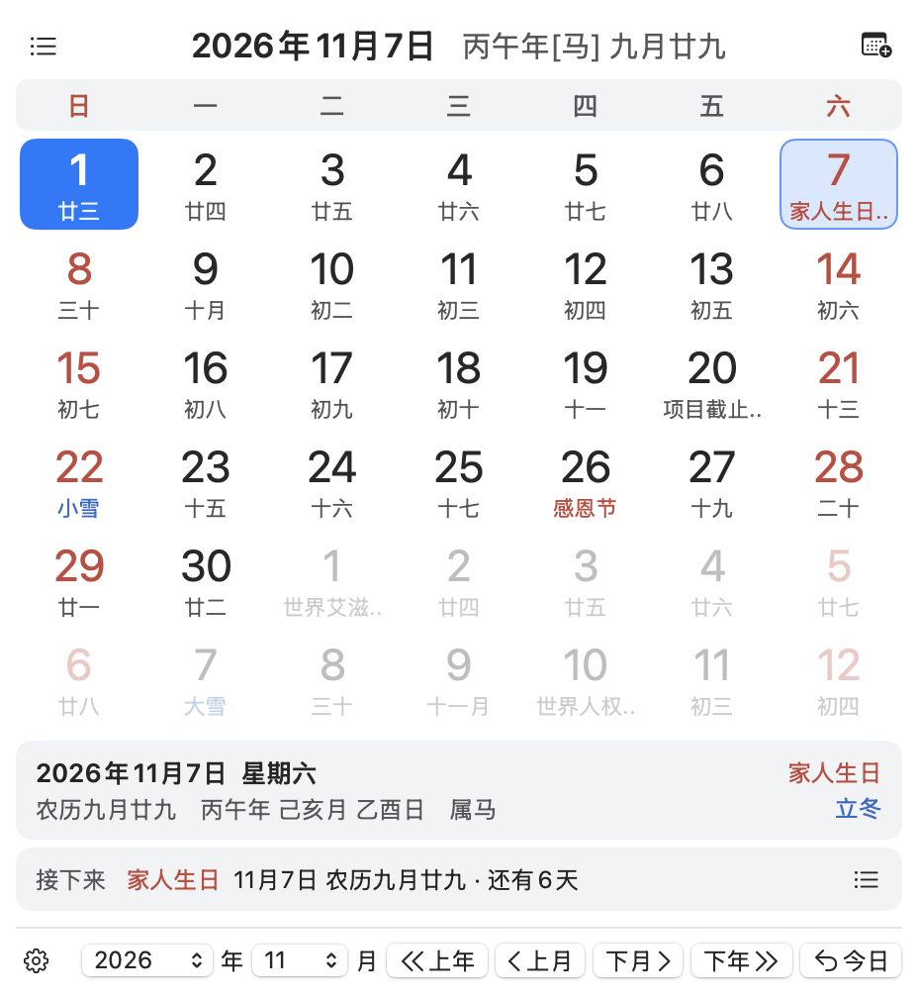
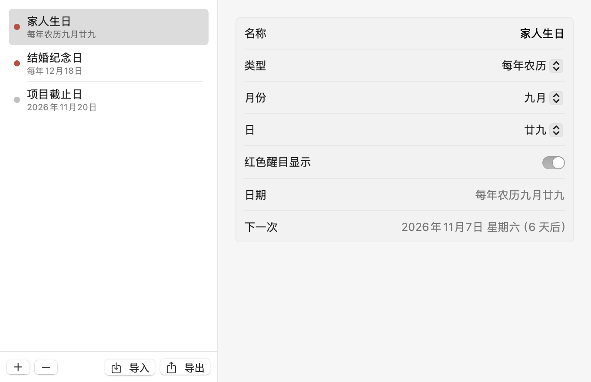

# 万年历 · Mac 菜单栏上的农历日历

点一下菜单栏，今天的农历、节气、放假调休和即将到来的重要日子一目了然。为家人记下农历生日，也为自己留住值得纪念的日期。

**免费开源 · macOS 13+ · 支持 Apple 芯片和 Intel 芯片 · 浅色与深色外观**

[官方网站](https://calendar.zfdang.com) · [下载最新版](https://github.com/zfdang/chinese-lunar-calendar-for-mac/releases/latest) · [更新历史](CHANGELOG.md)

## 随时查看，日子心中有数

- **农历就在菜单栏**：图标显示今天的日期，点击展开月历，查看农历、干支、生肖与二十四节气，支持 1901–2099 年。
- **放假还是上班**：按国务院公布的安排显示放假和调休上班，每周自动检查假日信息更新。
- **记住生日和纪念日**：支持每年农历、每年公历、某月第几个星期几及单次日期，适合家人生日、周年纪念和个人安排。
- **提前看看重要日子**：月历下方显示最近事件和倒计时；展开“即将到来”，可查看未来 90 天内最多 6 项，点击即可跳转。
- **选择你关心的节日**：传统节日、公历节日、常见西方节日、国内和国际纪念日可分别开关，也可选择英国各地区、美国、法国、德国的公共假日日历。同名节日合并显示并标注国家，国外节日不改变中国调休安排。
- **按自己的习惯使用**：支持跟随系统、日间和夜间外观，可设置开机自动启动；自定义日期可以导入、导出备份。

## 下载与安装

从[官方网站](https://calendar.zfdang.com)或 [GitHub Releases](https://github.com/zfdang/chinese-lunar-calendar-for-mac/releases/latest) 下载：

| 你的 Mac | 选择版本 |
| --- | --- |
| Apple M 系列芯片 | [Apple 芯片版](https://calendar.zfdang.com/WanNianLiSwift-AppleSilicon.zip) |
| Intel 芯片 | [Intel 芯片版](https://calendar.zfdang.com/WanNianLiSwift-Intel.zip) |

不确定芯片类型时，打开苹果菜单 →“关于本机”查看。新版需要 **macOS 13 或更新版本**；较早的系统可下载[旧版程序](https://calendar.zfdang.com/WanNianLi.app-u.zip)。

1. 下载并解压，将 **WanNianLiSwift.app** 拖入“应用程序”文件夹。
2. 打开应用，点击菜单栏的日期图标即可使用。
3. 如需开机启动，在日历左下角的设置菜单中开启“自动启动”。

应用尚未经过 Apple 公证。首次打开如被 macOS 阻止，可在“系统设置 → 隐私与安全性”中查看提示，并允许打开你确认从上述地址下载的应用。

## 从这里开始

**查看一天的详情**：点击日期，农历和当天事件会显示在下方。右侧最多使用两行显示节日、生日和节气，切换日期时面板高度不变。多个事件各自保留颜色：醒目事件为红色，普通事件为正常文字色，节气为蓝色；悬停可查看完整内容。

**添加生日或纪念日**：点击月历右上角的日历加号，或从设置菜单打开“自定义日期”，点击“＋”添加。家人的农历生日选择“每年农历”，公历生日选择“每年公历”，以后会自动出现在对应日期和“即将到来”中。

**快速浏览月份**：使用底部年月选项和翻页按钮，也可以按 ← / → 切换年份、↑ / ↓ 切换月份，按回车回到今天。按住 Command 拖动菜单栏图标，可调整它的位置。

## 4.5.1 更新

- 修复“接下来”一行中事件名称被挤掉的问题。
- 节日、生日和节气回到日期详情右侧，多个事件利用两行显示，面板高度保持稳定。
- 每个事件独立着色，同一天的生日不再把其他纪念日一起染红。

更多版本变化见[更新历史](CHANGELOG.md)。

## 帮助与反馈

遇到问题或有功能建议，欢迎[提交 Issue](https://github.com/zfdang/chinese-lunar-calendar-for-mac/issues)。描述系统版本、应用版本和复现步骤，附上截图会更方便定位。

开发、构建和测试见[开发说明](WanNianLiSwift/DEVELOPMENT.md)；发布步骤见[发布流程](RELEASE.md)；节日数据的来源和范围见[节日说明](WanNianLiSwift/Data/FESTIVALS.md)。仓库也保留了旧版实现，供历史版本维护与参考。

## 许可证

本项目以 [MIT 许可证](LICENSE) 开源。旧版中的第三方组件沿用各自许可证；新版节日数据的来源与许可见[节日说明](WanNianLiSwift/Data/FESTIVALS.md)。
